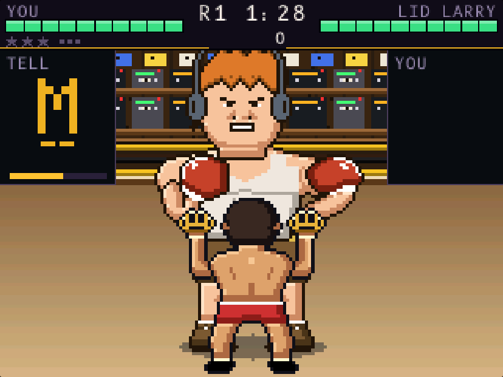

# Brass Knuckles Knock Out

*Sponsored by The Brass Knuckle Gang*

A boxing game that teaches Morse code. Every opponent sends a Morse character before each
punch: key the same character back to dodge, then counter. All dits jab, all dahs hook, mixed
characters throw combos. Eight fighters, from LID LARRY to BARON VON KILOWATT, add characters
in Koch order as you climb the ladder.

**Created by Derick, KO6PBZ.** Built on the HamCube PocketCW firmware by Kristen, K5MME.

It was written for the HamCube's PocketCW firmware. This is the same game code, built for
WebAssembly, so it plays in any web browser. Sound comes out of your speakers: the tells, your
sidetone and the static.

## Play

Open `index.html` in a browser, or the site's address once it is hosted (see below). Click the
page or press any key to start, with the sound on.

| Key | Does |
| - | - |
| `Z` and `X` | Dit and dah paddles. Hold both to squeeze. |
| Left and right `Ctrl` | Dit and dah too, for a USB paddle adapter that types Ctrl keys. |
| `Space` or `Enter` | The dial click: pick a fighter, ring the bell, pause. |
| `←` and `→` | Turn the dial: the next or previous fighter. |
| `1` to `4` | F1 to F4. In a fight, F2 spends a star on an uppercut. `Esc` is F4 too. |

On a phone or tablet, tap the buttons under the screen.

Your fighters, best scores, letter statistics and keyer settings stay in the browser you play in.

## Play online

https://n9ho.github.io/brass-knuckles-knock-out/

## Modding the original device

The game was written for the HamCube running the PocketCW firmware. The firmware, its docs and
its releases live in Kristen's repository:
**[kvmet/k5mme_pocketcw](https://github.com/kvmet/k5mme_pocketcw)**. The `source/` folder here
holds the game's own code (rules, screens and pixel art) and the browser build; build and flash
instructions for the device are in the firmware repository.

## Credits

- **Derick, KO6PBZ**: created the game.
- **Kristen, K5MME**: the HamCube PocketCW firmware it is built on.
- **The Brass Knuckle Gang** ([bkg.club](https://bkg.club)): sponsor.
- Hosted by Justin, N9HO, with Derick's permission.

## What is in this folder

| File | What it is |
| - | - |
| `index.html` | The whole game in one page, with the game code embedded. |
| `favicon.png` | The browser tab icon: the gang's brass knuckles. |
| `preview.png` | The screenshot above. |
| `LICENSE` | The GNU General Public License, version 3. |
| `THIRD-PARTY.txt` | Notices for the Rust crates and fonts the game includes. |
| `source/` | The source code `index.html` is built from. See `source/README.md`. |
| `.nojekyll` | Tells GitHub Pages to serve the files as they are. |

## License

Brass Knuckles Knock Out is part of PocketCW (https://github.com/kvmet/k5mme_pocketcw), and is
free software under the GNU General Public License, version 3 or later: see `LICENSE`. Because
`index.html` contains compiled code, the license asks that its source travels with it: that is
the `source` folder, so keep it in the repository.
